# 🥋 AI Taekwondo Coaching Kiosk: Case Study

A kiosk for taekwondo schools that watches a student perform a poomsae through one webcam. It recognises every movement in order, scores it against skilled performers, and gives posture feedback. It runs live on a consumer GPU, with no server.

> I built this at my previous company (January – November 2026) and handed it over to a new team. The code, models and data belong to the company and are not public. This page is shared with the company's permission and contains no training data, student data or company resources.

| | |
|---|---|
| **Role** | AI engineer: computer vision pipeline, kiosk app integration, releases, field tests, handover |
| **Team** | Two developers. I owned the AI pipeline and the kiosk app; my teammate built the voice AI coach |
| **Stack** | Python · PyTorch · ONNX Runtime · RTMPose · YOLO26 · DTW · PySide6 / QML · SQLite |

| 8 forms | ~28 fps | 26 keypoints | 5 scores | 12 releases | 1,372 tests | 12-chapter guide |
|:-:|:-:|:-:|:-:|:-:|:-:|:-:|
| Taegeuk 1–8 | live on the kiosk GPU | per frame | per movement | Jul → Nov | passing | English + Korean |

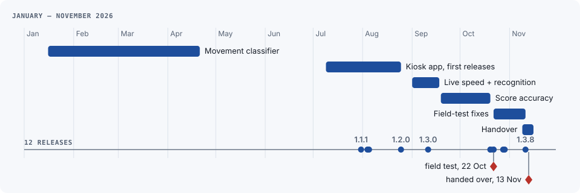

---

## How it works

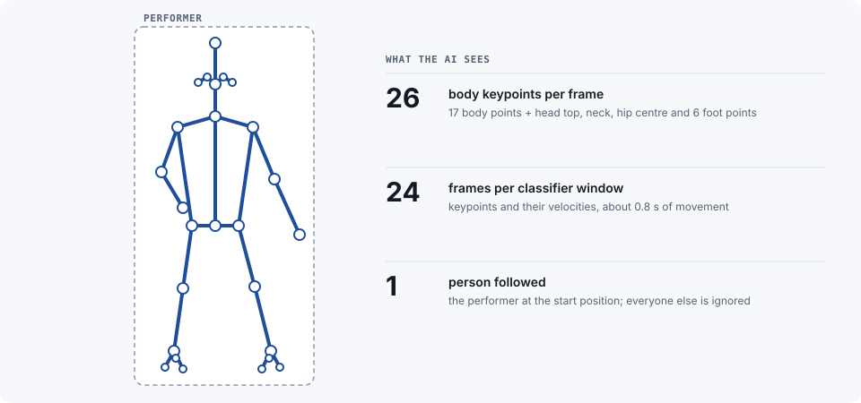

---

## Engineering highlights

### 1. Following the right person

A busy dojang has parents, instructors and other students in view. In the first field test the tracker followed a seated observer, so exam runs stopped at the first movement.

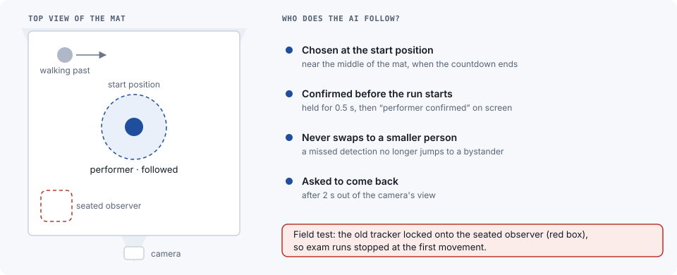

### 2. Recognising movements strictly in order

A per-frame classifier is noisy, and some movements look alike. I built a step segmenter where every guess passes a ladder of rules, each added after a failure in a recording or a live test.

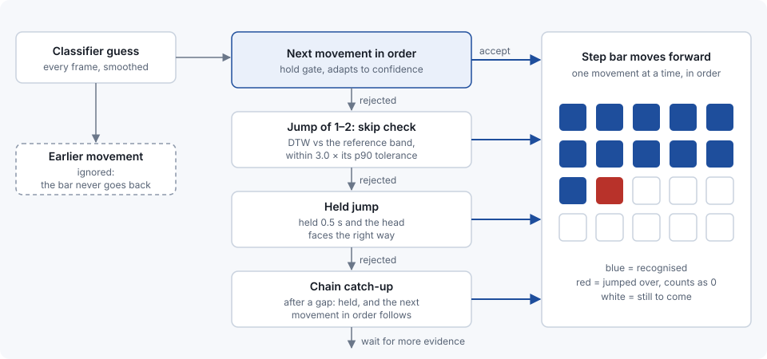

Result: clean runs reach the end with all 20 movements, and the bar catches up after the camera loses the student for a few seconds.

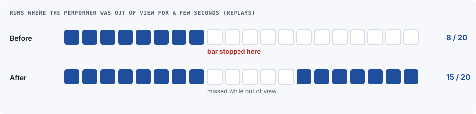

### 3. The bug only a live camera could show

The catch-up rules worked in replays but almost never live. The recogniser's clock could step backwards and reset its timers. Replays used a fixed frame rate, so the bug never showed there.

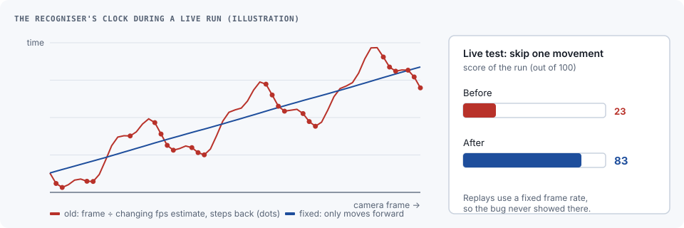

### 4. Making the live skeleton keep up

The skeleton lagged on fast movements. Forcing all AI inference onto the CPU disproved my first theory (GPU contention). Profiling the GIL led to the real causes:

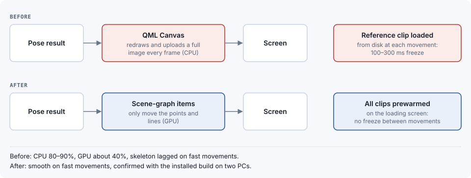

### 5. Can the score be trusted?

The instructor evaluations available were all of skilled performers at the same level, so agreeing with them couldn't prove anything. Instead I injected known errors into real keypoints and checked that the right score reacted.

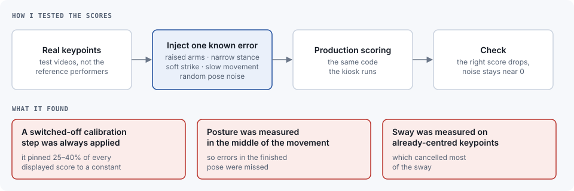

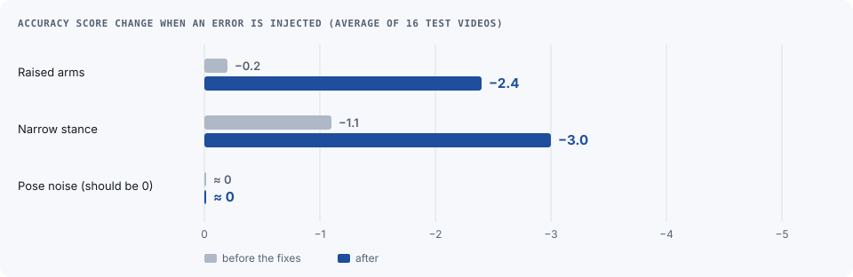

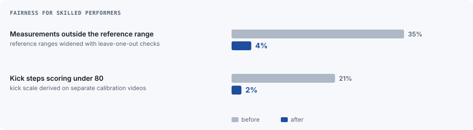

The field test showed a beginner and an advanced student still scoring almost the same. The live kiosk path was still using the old formulas. Once it was connected:

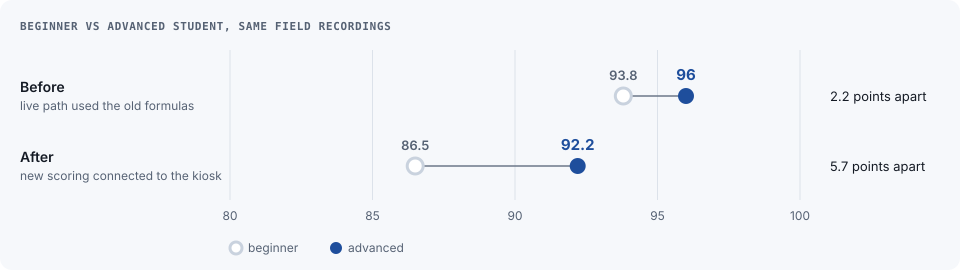

### 6. Shipping to kiosks

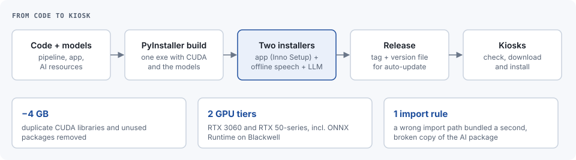

### 7. Handing it over

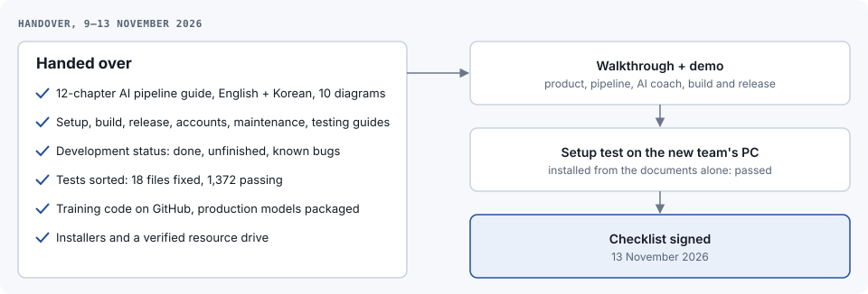

| The AI pipeline guide (English) | The same guide in Korean |
|:-:|:-:|
|  | 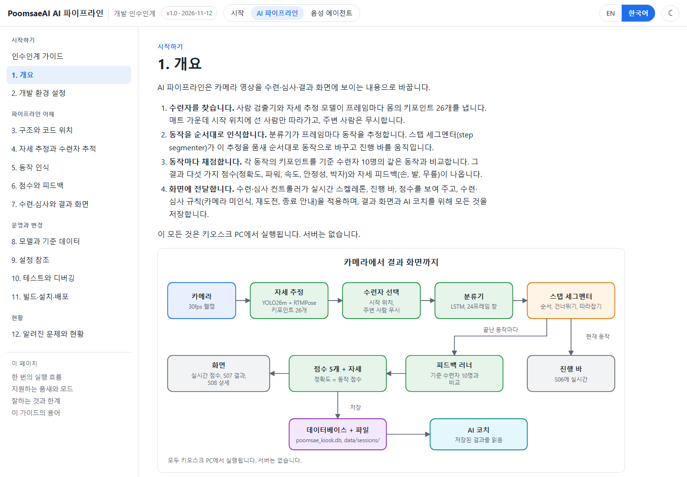 |

---

## What I learned

- **Design tests that can prove you wrong.** Forcing the CPU disproved my own theory; error injection found bugs that label correlation never would.
- **Test what the user actually sees.** The clock bug and the scoring bug both existed only in the live path.
- **Check what the labels can tell you before fitting to them.** Labels from one skill level can't validate a score meant to separate levels.
- **Write the reason next to every rule.** Each recognition constant names the recording or test behind it.
- **The handover is part of the product.** The new team set the system up from the documents alone.

---

## Tech stack

| Area | Tools |
|---|---|
| Pose | YOLO26m person detector, RTMPose (26 keypoints), ONNX Runtime GPU |
| Recognition | PyTorch LSTM per form (24-frame windows), rule-based step segmenter, DTW skip check |
| Scoring | Reference performer comparison: whole-body distance, posture ranges, DTW movement paths, technique scaling |
| App | PySide6 / QML kiosk (11 screens), worker threads, SQLite, InsightFace face login |
| Voice AI coach (teammate) | Wake word, speech recognition, LLM with knowledge base, text-to-speech; online and offline |
| Operations | PyInstaller, Inno Setup, auto-update, kiosk backup, performance logging |
| Quality | pytest (1,372 tests), error-injection tests, live acted tests, dojang field tests |

<!--
Kiosk screens: add your own captures to images/ and uncomment.
Use only your own runs: no students, field-test footage or instructor documents.

| Choose a form | Practice | Report |
|:-:|:-:|:-:|
|  |  |  |
-->

Diagrams and charts were made for this page from project measurements; they contain no real student data.
