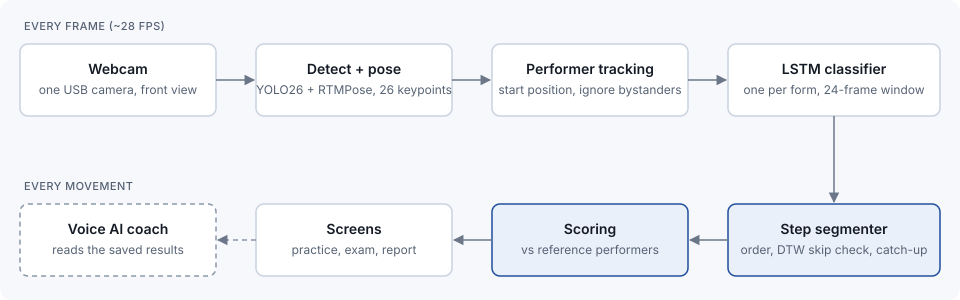
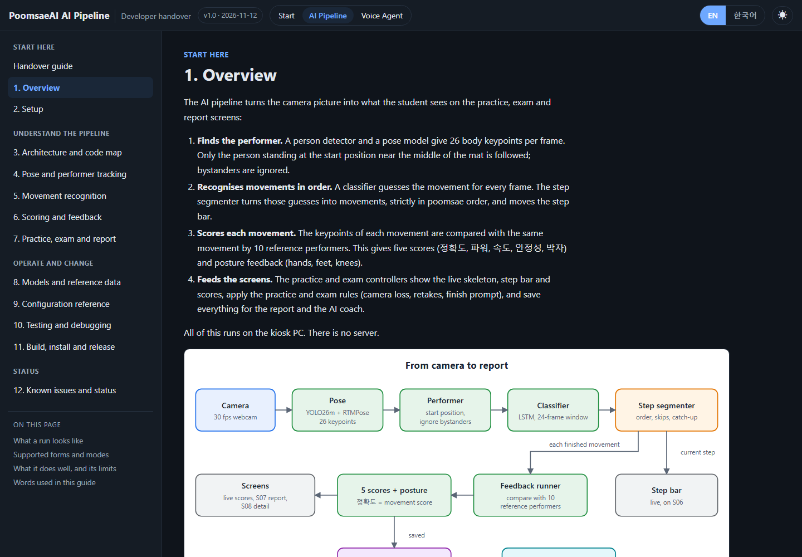

# 🥋 AI Taekwondo Coaching Kiosk: Case Study

A Windows kiosk for taekwondo schools that watches a student perform a poomsae (the Taegeuk 1–8 forms) through one webcam. It recognises every movement in order, scores each one against skilled reference performers, and shows a report with posture feedback. Everything runs on the kiosk PC, with no server.

> **About this page.** I built this system at my previous company, from January to November 2026, and handed it over to a new team. The source code, models and data belong to the company and are not public. This page describes my work with the company's permission and contains no training data, student data or company resources.

| | |
|---|---|
| **My role** | AI engineer: the computer vision pipeline (pose, recognition, scoring), its integration into the kiosk app, releases, field testing and the handover |
| **Team** | Two developers. I owned the AI pipeline and the kiosk app; my teammate built the voice AI coach |
| **Period** | January – November 2026 (training from January; kiosk app from July; final release 1.3.8 in November) |
| **Stack** | Python 3.10 · PyTorch (LSTM) · ONNX Runtime (GPU) · RTMPose · YOLO26 · DTW · PySide6 / QML · SQLite · InsightFace · PyInstaller · Inno Setup |

---

## At a glance

| | |
|---|---|
| **8 forms** | Taegeuk 1–8 recognised movement by movement, strictly in order |
| **~28 fps** | analysed live on the kiosk (RTX 5060 Ti); pose about 9 ms per frame on the GPU |
| **26 keypoints** | per frame, for the one performer at the start position; bystanders are ignored |
| **5 scores** | per movement (accuracy, power, speed, stability, rhythm), plus hand, foot and knee feedback |
| **12 releases** | from 1.1.1 (July) to 1.3.8 (November), shipped to kiosks through auto-update |
| **1,372 tests** | passing at handover |
| **12 chapters** | bilingual (English/Korean) developer guide with 10 diagrams; the new team set up the system from the documents alone |

---

## The problem

In a taekwondo school, one instructor can't watch every student practise every form. The kiosk gives each student an instructor's eye: stand on the mat, perform, and get told which movements were missed and how each one compares with skilled performers.

The constraints shaped every decision:

- **One ordinary webcam, front view only.** No depth camera and no motion capture.
- **A consumer GPU in a kiosk**, running offline, with no server.
- **A busy room.** Parents, instructors and other students walk behind the performer.
- **Real students**, including beginners who pause, skip movements, restart, or step out of view.
- **Practice and exam modes.** In the exam, every rule has to be fair and explainable.

---

## How it works

1. **Find the performer.** A YOLO26 person detector and an RTMPose model give 26 body keypoints per frame. Only the person standing at the start position, near the middle of the mat, is followed.
2. **Recognise movements in order.** An LSTM classifier per form reads a sliding window of 24 frames (keypoints plus velocities) and guesses the movement for every frame. A step segmenter turns those guesses into movements, strictly in poomsae order, and moves the step bar on screen.
3. **Score each movement.** The movement's keypoints are compared with the same movement by skilled reference performers. Posture measurements (stance width, knee angle, hand height) are checked against the references' range, and the movement path is aligned with DTW.
4. **Show it.** The practice and exam screens show the live skeleton, step bar and scores. The report shows the total, the five scores, a score per movement, side-by-side replays with the reference performers, and posture feedback. The voice AI coach reads the same results to answer questions about the student's own runs.

---

## Engineering highlights

### 1. Making the live skeleton keep up

**Problem.** On the kiosk GPU the skeleton lagged behind the student on fast movements. CPU use was 80–90% while the GPU sat at about 40%.

**What I did.** I treated each theory as something to disprove:
- "GPU contention" looked convincing in the logs. Forcing all AI inference onto the CPU changed nothing, so that theory was wrong, and I said so in my next report.
- A thread that only sleeps 20 ms in a loop showed Python's GIL being held for 60–100 ms at a time.
- Tracing it led to the real causes:
  - The skeleton overlay was drawn on a QML Canvas, which re-uploads a full image every frame.
  - A frame-ID bug compared fresh pose results with stale timestamps.
- I rewrote the overlay with native QML scene-graph items and fixed the frame correlation.
- Along the way I fixed three more problems:
  - Each movement's reference clip was loaded from disk at the moment the student started that movement, a 100–300 ms freeze every time. Prewarming all clips on the loading screen removed it.
  - The camera preview sampled about one pixel per frame.
  - The app hung at boot when the saved camera was a disconnected virtual device. Camera probing now has a 5 s timeout.

**Result.** Smooth tracking on fast movements, confirmed with the installed build on both the kiosk PC and the development PC.

### 2. Recognising movements strictly in order

**Problem.** A per-frame classifier is noisy, and some movements look alike (in Taegeuk 1, movements 2 and 15, and 4 and 18). If the step bar follows every guess, it jumps ahead and skips movements the student actually performed. If it refuses every jump, one missed movement stops it for the rest of the run.

**What I did.** I built a step segmenter with layered rules, each added because of a failure seen in a recording or a live test:
- **Hold gate.** A new movement counts only once the smoothed guess holds. The gate adapts to confidence: high confidence fires a frame earlier, low confidence needs a frame more.
- **Skip check.** Before a jump ahead is accepted, the recent keypoints are aligned with the candidate movement's reference band using DTW. The distance must fall within a multiple of the band's own p90 tolerance. My first tolerance (1.5×) came from clean recordings and stalled a real Taegeuk 8 run for over a minute. I raised it to 3.0× and re-checked that the misfire tests still failed as they should.
- **Held jump.** If the skip check rejects a jump but the classifier keeps predicting that movement for 0.5 s, the jump is still accepted when the head faces the way that movement's reference does.
- **Chain catch-up.** After a long gap, a jump is accepted when a later movement is held and the next one in order follows. It's never accepted after a restart, and never further than the student could have moved in the elapsed time.

**Result.** Clean runs reach the end with all 20 movements, and short camera losses (up to about 5 s) are recovered.

### 3. The bug only a live camera could show

**Problem.** In live tests, the held-jump and catch-up rules almost never fired, but in replayed recordings they worked.

**Cause.** The segmenter's clock was `frame_number / fps`, using an fps estimate that changed every frame. Live, time could step backwards and reset the hold timers. Replays used a fixed frame rate, so the bug never appeared there.

**Fix.** I made the stream clock monotonic. In an acted test where the performer skipped one movement, the score went from 23 to 83.

**Lesson.** I made "test recognition changes live, with a person in front of the camera" a rule in the handover guide.

### 4. Following the right person

**Problem.** In a field test with students in a dojang, exam runs stopped at the first movement. The tracker had locked onto a seated observer, and on another run it switched to a smaller bystander after a 4-frame detection miss.

**What I did.**
- The performer is chosen afresh at the start position near the middle of the mat, and a size-ratio rule stops the tracker switching to a smaller person.
- The run now starts only once a performer has held the start position for half a second, and "performer confirmed" is shown on screen.
- If the performer leaves the camera's view for 2 s, the screen asks them to come back.

**Result.** Replaying the field recording, the observer is ignored and the student is confirmed 0.7 s after stepping onto the mat.

### 5. Can the score be trusted?

**Problem.** Comparing the AI scores with instructors' written evaluations showed weak agreement. The obvious next step was to tune the formulas until they matched. I didn't, because the recordings were all of skilled performers at the same level. The real differences between them were tiny, and the differences between evaluators were larger. Agreement close to zero was expected whether the scoring was good or bad, so this comparison couldn't validate anything.

**What I did.** I changed the method. I injected known errors into real keypoints (raised arms, a narrow stance, a soft strike, a slow movement, random pose noise) and replayed them through the production scoring code. Each score had to react to its own error and ignore noise. This found concrete bugs:
- A calibration step that was meant to be switched off was always applied. It pinned 25–40% of every displayed score to a constant.
- Posture was measured in the middle of each movement, so errors in the finished pose were missed.
- Body sway was measured on keypoints that had already been centred, which cancelled most of the sway.

After the fixes, the injected errors were clearly detected and noise still scored about 0. Two fairness fixes followed:
- The reference ranges were too narrow, so skilled performers often fell outside them. I widened them using leave-one-out checks: measurements out of range dropped from 35% to 4%.
- Kicks scored 5–6 points lower in a 2D front view. I added a kick scale derived on a separate set of calibration videos: kick steps under 80 dropped from 21% to 2%.

**One more surprise.** In the next field test, a beginner and an advanced student still scored almost the same (93.8 vs 96). I traced it: the live kiosk path still used the old formulas, and the new scoring ran only in the offline tools. Once connected, the same recordings scored 86.5 and 92.

**Open at handover.** Calibrating scores across skill levels needs ratings of students at different levels. I documented this as the next step for the new team.

### 6. Shipping to kiosks

- A PyInstaller build with an Inno Setup installer. I cut about 4 GB of duplicate CUDA libraries and unused packages from it.
- A separate offline resources installer for the speech model and the local language model.
- Auto-update: kiosks check a version file and download the new installer.
- Two GPU tiers (RTX 3060 and RTX 50-series), including ONNX Runtime on the new Blackwell GPUs.
- Faster boot, after I removed a slow loading path that blocked model loading.
- A packaging bug: one wrong import path made the build bundle a second, partial copy of the AI package. Recognition worked from source but not in the installed app. The import rule is now in the guide.
- Per-run performance lines in the log ("[AI perf]": frames per second and time per stage), so field problems can be diagnosed from the logs.

### 7. Handing it over

The project moved to a new team when I left, so I made sure it could survive without me:
- A 12-chapter developer guide for the AI pipeline, in English and Korean, with 10 diagrams. It's published as a small website with a start page that links it to the voice AI coach's guide.
- Guides for setup, build and deployment, releasing a new version, the accounts and services the kiosk uses, maintenance, testing, and the development status (completed, unfinished, known bugs).
- Failing tests sorted and 18 test files fixed. Each remaining failure is listed with its likely cause.
- The classifier training code published with setup steps, and the production models packaged so they can be retrained.
- A walkthrough and demo, then a setup test: the new team installed the system on their own GPU PC from the documents alone. The handover checklist was signed.

---

## What I learned

- **Design tests that can prove you wrong.** Forcing the CPU disproved my own GPU-contention theory, and error injection showed bugs that correlation with labels never would.
- **Test what the user actually sees.** Two of my biggest bugs (the stream clock, and the scoring path) only existed in the live path, not in replays or offline tools.
- **Check what the labels can tell you before fitting to them.** Labels from one skill level can't validate a score meant to separate levels.
- **Every rule needs a reason written next to it.** Each recognition constant in the code names the recording or test behind it, so the next team can change it safely.
- **The handover is part of the product.** The new team set the system up from the documents alone, and that was the real test of them.

---

## Tech stack

| Area | Tools |
|---|---|
| Pose | YOLO26m person detector, RTMPose (26 keypoints), ONNX Runtime GPU |
| Recognition | PyTorch LSTM per form (24-frame windows), rule-based step segmenter, DTW skip check |
| Scoring | Comparison with reference performers: whole-body distance, posture measurement ranges, DTW movement paths, technique-specific scaling |
| App | PySide6 / QML kiosk (11 screens), worker threads, SQLite, InsightFace face login |
| Voice AI coach (teammate) | Wake word, speech recognition, LLM with a knowledge base, text-to-speech; online and offline modes |
| Operations | PyInstaller, Inno Setup, auto-update, kiosk backup, structured performance logging |
| Quality | pytest (1,372 tests), error-injection scoring tests, live acted tests, field tests in a dojang |

---

Screens and diagrams on this page contain no real student data. Product names and logos belong to their owners.
